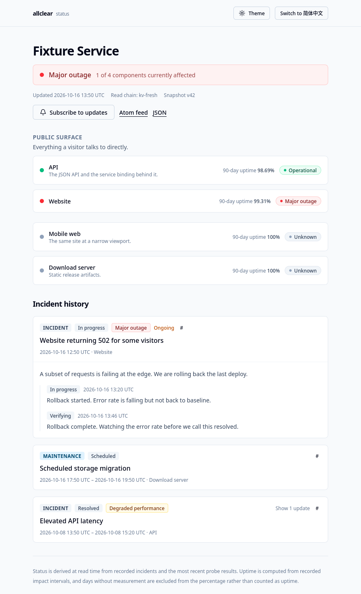

<div align="center">

# allclear

**An open-source status page and basic availability monitor for Cloudflare's serverless platform**

Public status page · automatic availability probing · uptime computed from real measurements

[](LICENSE)

[中文](README.md) · [Engineering notes](docs/engineering.md) · [Specifications](docs/spec/)

</div>

---

## Overview

`allclear` gives you a public status page running in your own Cloudflare account:
a component tree, an incident and maintenance timeline, 90-day uptime history, email
subscriptions, zh-CN/en-US, and dark mode. It depends on no third-party hosted service —
every resource lives in your account.

What separates it from a status page with a hand-typed "99.9%" is where the numbers come
from. A per-minute prober keeps requesting the endpoints you configure and records the
failures and recoveries it observes as `impact` intervals; every uptime percentage on the
page is computed from those records. There is no path that writes a percentage by hand.

If you already run on Cloudflare and want a status page that shares the account with your
service, keeps its trust boundaries explicit, and adds no SaaS dependency, this is built
for that.

## Features

### Public status page (`/status/:slug`)

- **Component tree** grouped into sections, with each component's status derived at read
  time.
- **Incident and maintenance timeline** with expandable entries and deep links
  (`#change-<public_id>` jumps straight to one).
- **90-day uptime history** in three views: bar strip, month calendar, table.
- **Email subscriptions** with per-component scoping, double opt-in, and RFC 8058
  one-click unsubscribe.
- **zh-CN / en-US, dark mode**, responsive down to 375px.
- **Atom feed** (`/status/:slug/feed.xml`) and a machine-readable
  `/status/:slug/snapshot.json`.

### Automatic availability probing

- Admin-configured HTTP probes on a per-minute scheduler.
- A **persisted state machine** with failure and recovery thresholds, so a single failed
  request does not open a public incident.
- Probe transitions open and close `impact` intervals automatically, preserving the real
  observation timestamps.

### Admin console (`/admin`)

- Page, section, component, probe target, change and manual-impact management.
- A **budget panel** showing probe-target and daily-email headroom.
- A **snapshot panel** that reads the *public* endpoint, so a stale snapshot is
  discoverable from the console.

## Preview



> The screenshot above is rendered from the project's own fixture data. There is no public
> demo instance.

## Deploying to Cloudflare

Everything runs on Cloudflare: a Hono API Worker (public read API, admin API, probe
scheduler), a Next.js web Worker (status page and console), plus D1 and KV. The steps below
take it from nothing to reachable in your own account.

### Prerequisites

- A Cloudflare account. The free plan works, but note the
  [D1 read-subrequest limit on Free](docs/engineering.md#capacity-boundaries-v1).
- Node.js 20+ and npm.
- A `*.workers.dev` subdomain enabled on the account. Registering a cron trigger requires
  the subdomain to exist **even for a Worker that is not publicly reachable** — this is an
  observed result, recorded in the [M0 findings](docs/spec/m0-findings.md).
- Wrangler logged in: `npx wrangler login`. Or supply `CLOUDFLARE_API_TOKEN` and
  `CLOUDFLARE_ACCOUNT_ID` in front of each command.

### 1. Clone and install dependencies

This is not an npm workspaces monorepo — each package installs its own dependencies:

```sh
git clone https://github.com/ZYongX09/AllClear
cd AllClear
npm --prefix packages/shared install
npm --prefix apps/api install
npm --prefix apps/web install
```

### 2. Create the D1 database and KV namespace

```sh
cd apps/api
npx wrangler d1 create allclear-db
npx wrangler kv namespace create SNAPSHOT_KV
```

Put the `database_id` and `id` each command prints into `apps/api/wrangler.jsonc`:

```jsonc
"d1_databases": [
  { "binding": "DB", "database_name": "allclear-db", "database_id": "<your database_id>" }
],
"kv_namespaces": [
  { "binding": "SNAPSHOT_KV", "id": "<your KV id>" }
]
```

> `wrangler.jsonc` deliberately omits `account_id`: the account is supplied per environment
> through `CLOUDFLARE_ACCOUNT_ID`. Keep the database name `allclear-db`; renaming it also
> means updating the migration scripts in `apps/api/package.json`.

### 3. Apply the database migrations

```sh
cd apps/api
npm run db:migrate:remote   # wrangler d1 migrations apply allclear-db --remote
```

### 4. Set the secrets

The API Worker reads two secrets. Write them with Wrangler:

```sh
cd apps/api
npx wrangler secret put INTERNAL_KEY          # shared web -> api key; generate a random string
npx wrangler secret put UNSUBSCRIBE_HMAC_KEY  # signs unsubscribe links; unset means no mail is sent
```

The web Worker reads `INTERNAL_KEY` (**the same value**) and `ADMIN_TOKEN` (the passphrase
you sign in to `/admin` with). Its configuration lives in `cloudflare.config.ts` rather than
`wrangler.jsonc`, so those two are written during the **first deploy** — see the next step.

> Do not put secrets in command-line arguments or pipe them through `echo` — they end up in
> your shell history. Use the interactive prompt, or point `--secrets-file` at a file outside
> the repository.

### 5. Deploy both Workers

Deploy the API first:

```sh
cd apps/api
npx wrangler deploy
```

Then the web Worker. **The first deploy must go through `cf` with a secrets file**:
`vinext-cloudflare deploy` does not forward `--secrets-file`, and the Worker does not have
those two secrets yet.

```sh
cd apps/web
npm run build

# outside the repository, e.g. ~/.config/allclear/web-secrets.env
cat > ~/.config/allclear/web-secrets.env <<'EOF'
INTERNAL_KEY=<the same value as the API Worker>
ADMIN_TOKEN=<your admin passphrase>
EOF

CLOUDFLARE_API_TOKEN=<token> CLOUDFLARE_ACCOUNT_ID=<account> \
  npx cf deploy --prebuilt --secrets-file ~/.config/allclear/web-secrets.env
```

Once the secrets exist on the Worker, ordinary deploys use the normal command:

```sh
cd apps/web && npm run deploy
```

> `cf` and Wrangler are two independent credential systems: `cf` only accepts
> `CLOUDFLARE_API_TOKEN` or its own OAuth login and does **not** reuse Wrangler's session.
> That and the other deployment-time traps are recorded in full in the
> [M0 findings](docs/spec/m0-findings.md).

### 6. Sign in for the first time

Open `https://<your web Worker hostname>/admin` and sign in with `ADMIN_TOKEN`. From the
console you can create pages, sections, components and probe targets; the status page then
generates its content from the probe results.

> Deployment is manual — there is no CI pipeline that publishes on push. A successful
> `git push` is **not** evidence of a successful deployment; verify by hitting the deployed
> Worker.

## Configuration reference

| Where | Name | Kind | Required | What it does |
| --- | --- | --- | --- | --- |
| `apps/api` | `DB` | D1 binding | yes | Source of truth: every entity and probe record |
| `apps/api` | `SNAPSHOT_KV` | KV binding | yes | Published snapshots |
| `apps/api` | `INTERNAL_KEY` | secret | yes | Shared key for `/internal/*`; empty disables the internal namespace |
| `apps/api` | `UNSUBSCRIBE_HMAC_KEY` | secret | no | Signs unsubscribe links; unset means subscriptions work but no mail is sent |
| `apps/api` | `PUBLIC_BASE_URL` | var | recommended | Source of absolute links in email and the Atom feed |
| `apps/api` | `EMAIL_FROM` | var | no | Envelope sender address |
| `apps/api` | `MAX_TARGETS_PER_RUN` | var | no | Probe targets per cron tick, capped at 20 |
| `apps/web` | `API` | Service Binding | yes | Points at `allclear-api` |
| `apps/web` | `INTERNAL_KEY` | secret | yes | The same value as the API side |
| `apps/web` | `ADMIN_TOKEN` | secret | yes | `/admin` passphrase; empty refuses every admin action |
| `apps/web` | `DEFAULT_STATUS_SLUG` | var | no | Which status page the landing page links to; defaults to `example` |

## Architecture

```
                    ┌─────────────────────────────┐
   browser ────────▶│  allclear-web               │
                    │  Next.js (vinext)           │
                    │  • public status page       │
                    │  • /admin console           │
                    │  • Server Actions (writes)  │
                    └───────────┬─────────────────┘
                                │  Service Binding
                                │  + X-Internal-Key
                                ▼
                    ┌─────────────────────────────┐
   cron ───────────▶│  allclear-api               │
                    │  Hono Worker                │
                    │  • public read API          │
                    │  • /internal/admin/*        │
                    │  • probe scheduler          │
                    └───────────┬─────────────────┘
                                │
                    ┌───────────┴───────────┐
                    ▼                       ▼
                 D1 (source of truth)    KV (published snapshots)
```

`allclear-api` is deployed with **no public route**. The web Worker reaches it over a
Service Binding, and that reachability is *not* treated as authentication — every
`/internal/*` route additionally requires the shared `INTERNAL_KEY`. The browser never holds
any admin credential.

## Local development

**Look at the UI without any Cloudflare resources** — fixture Workers supply the data, so it
renders with no D1, no KV and no migrations:

```sh
cd apps/web
npx vite dev --config verify/vite.config.verify.ts --port 5219
```

Open <http://localhost:5219/status/fixture>. The first compile is slow; that is expected.

**Test, type-check and build:**

```sh
npm run typecheck   # builds packages/shared, then type-checks all three packages
npm test            # packages/shared (pure Node), then apps/api (real workerd + D1)
npm run build       # builds packages/shared, then apps/web
```

`apps/api` tests run against a **real `workerd` runtime with a real D1 binding**, not mocks —
the design depends on specific SQLite behaviours (`db.batch()` rollback semantics,
conditional `UPDATE` matching zero rows, partial unique indexes, `meta.changes`), and mocks
would assert beliefs about those behaviours instead of the behaviours themselves.

After changing the schema in `apps/api`, apply migrations locally with
`npm run db:migrate:local` (`wrangler d1 migrations apply allclear-db --local`).

## Documentation

| Document | What it covers |
| --- | --- |
| [docs/engineering.md](docs/engineering.md) | Architecture, design commitments, the read chain, capacity boundaries, security posture, and the verification boundary |
| [docs/spec/state-machine.md](docs/spec/state-machine.md) | The fault state machine |
| [docs/spec/data-model.md](docs/spec/data-model.md) | The data model and the ID-role split |
| [docs/spec/probe.md](docs/spec/probe.md) | Probe scheduling, SSRF constraints, retention |
| [docs/spec/uptime-math.md](docs/spec/uptime-math.md) | The uptime algorithm (interval sweep) |
| [docs/spec/snapshot.md](docs/spec/snapshot.md) | Snapshot contract and consistency boundary |
| [docs/spec/admin-api.md](docs/spec/admin-api.md) / [admin-ui.md](docs/spec/admin-ui.md) | Admin API and console |
| [docs/spec/subscriptions.md](docs/spec/subscriptions.md) | Subscriptions, unsubscribe, send quota |
| [docs/spec/testing.md](docs/spec/testing.md) | How the suites are organised and what they run against |
| [docs/spec/visual-parity.md](docs/spec/visual-parity.md) | Visual verification record and its known gaps |
| [docs/spec/security-scan.md](docs/spec/security-scan.md) | The static security scan record (result: inconclusive) |
| [docs/spec/m0-findings.md](docs/spec/m0-findings.md) | What was observed on real Cloudflare infrastructure, and the workarounds |
| [AGENTS.md](AGENTS.md) | Working rules for this repository (branches, deployment, secrets, licensing) |

## Maturity and known limitations

The project has not had a release yet. A few things worth knowing before you use it — the
full list is in the [engineering notes](docs/engineering.md#verification-honesty):

- Neither the admin console nor the status page has **automated tests**, and no
  human-perspective visual review has happened.
- A deep static security scan came back **inconclusive**, so **this project must not be
  described as security-audited** — see the [scan record](docs/spec/security-scan.md).
- The status page and the prober both run on Cloudflare: **if Cloudflare itself is down, this
  system cannot report on it.** Detecting a full-platform outage requires a probe source
  outside Cloudflare; that is out of scope for now and is recorded as a risk rather than a
  solved problem.

## Contributing

This is primarily a personal project at the moment. Issues and pull requests are welcome.

`develop` is the development branch and `main` is the release branch. Feature work lands on
`develop`; merging into `main` is a deliberate release step. See [AGENTS.md](AGENTS.md) for
the full rules.

## License

**GNU General Public License v3.0** (SPDX: `GPL-3.0-only`) — full text in
[LICENSE](LICENSE).

Copyright (C) 2026 ZhX589, ZYongX09

Functionality was informed by studying mature commercial status-page products, but **all code
and assets in this repository are original**. No third-party stylesheets, markup, copy,
message catalogs, logos, or images were copied. Dependencies are all GPL-3.0-compatible
(MIT / ISC / OFL / Apache-2.0).
[OpenStatus](https://github.com/openstatusHQ/openstatus) is **AGPL-3.0** and is not a source
for this project's code.
